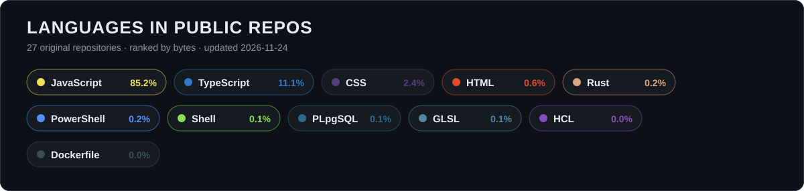
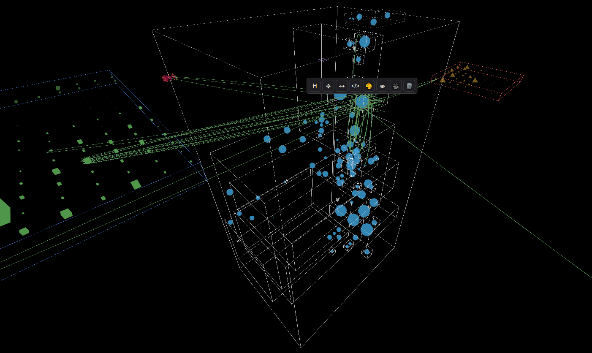
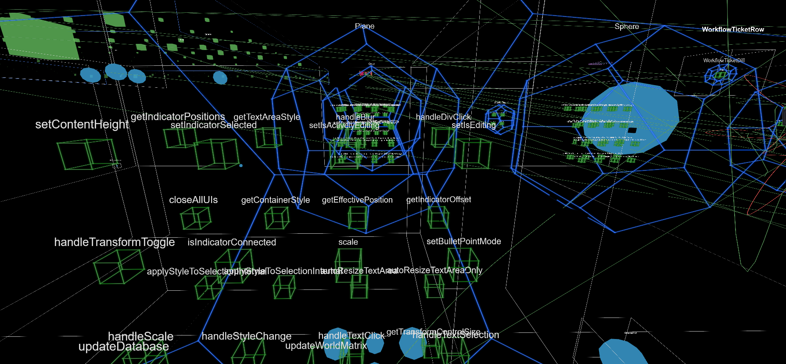
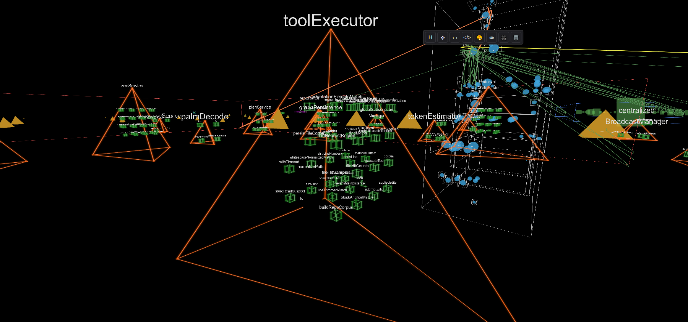
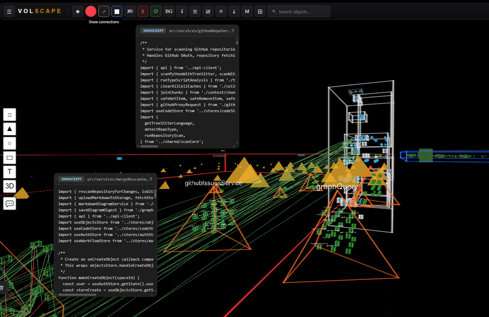
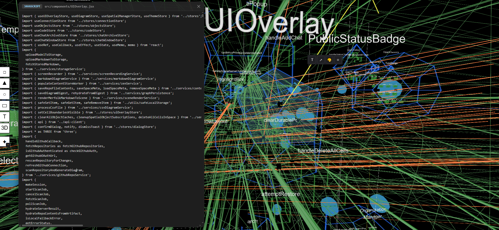

## `> whoami`

Mitchell Cook — full-stack and platform engineer building mapping systems, developer tooling and AI-powered tools.

## `> cat about.txt`

Focusing on full-stack engineering since 2021 and lately, Platform Engineering, DevOps, Mapping systems and integrating AI-powered tools. Background across, ITSM, Systems Engineering and technical support.

I care about viewing the bigger picture.

## `> cat skills.json`

 

Generated from the GitHub API across original public repositories (forks excluded) and refreshed daily by GitHub Actions. Raw data: [assets/skills/skills.json](./assets/skills/skills.json)

## `> gh repo list`

<b>Hoverchart</b> &nbsp;&nbsp; 

 

collaborative 3D code architecture visualization tool. It scans a GitHub repository, analyses its source code via AST parsing, and generates an interactive 3D diagram where components, hooks, services, stores, utilities, workers, and libraries are represented as geometric objects.

  
  
  
  
  
  
  
  
  
  

<table width="100%">
  <tr>
    <td></td>
    <td></td>
  </tr>
  <tr>
    <td></td>
    <td></td>
  </tr>
  <tr>
    <td></td>
    <td></td>
  </tr>
</table>

